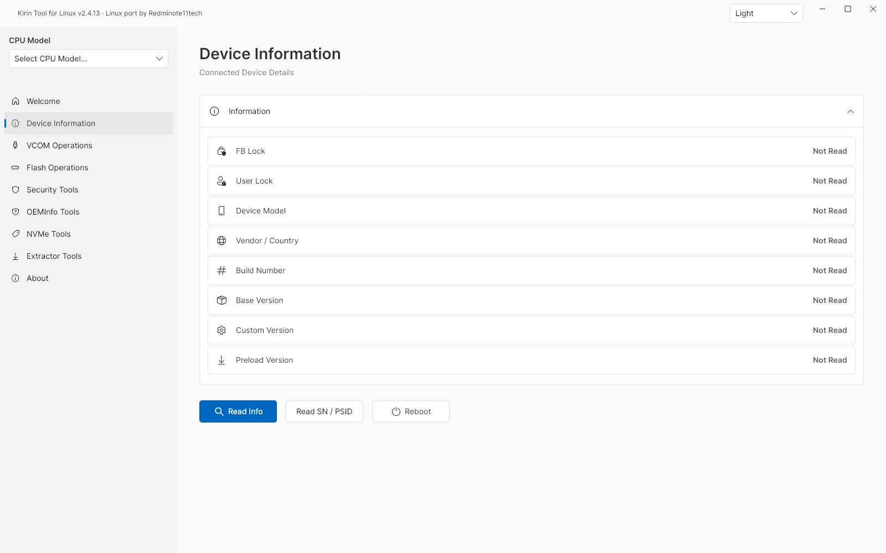
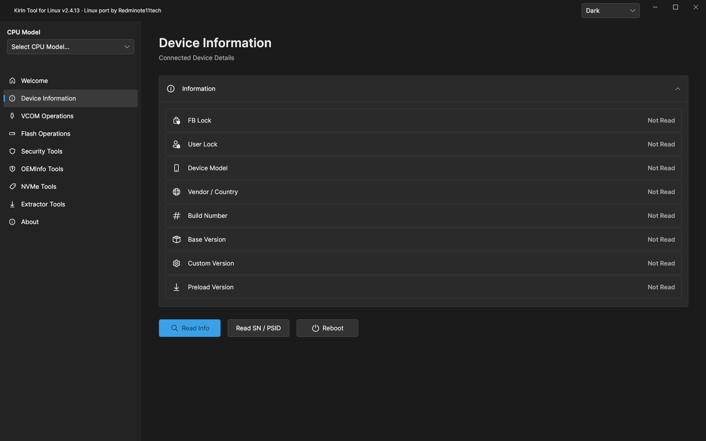
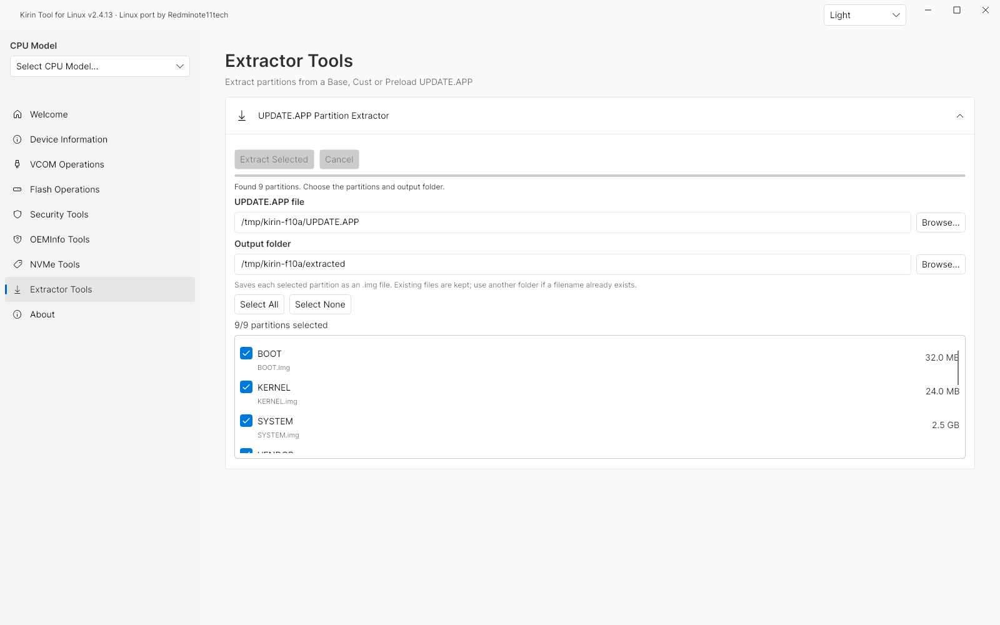
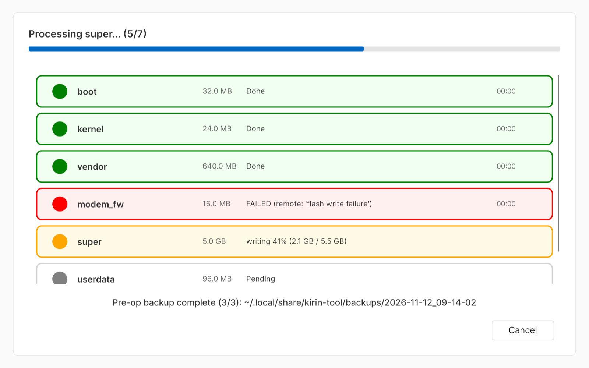
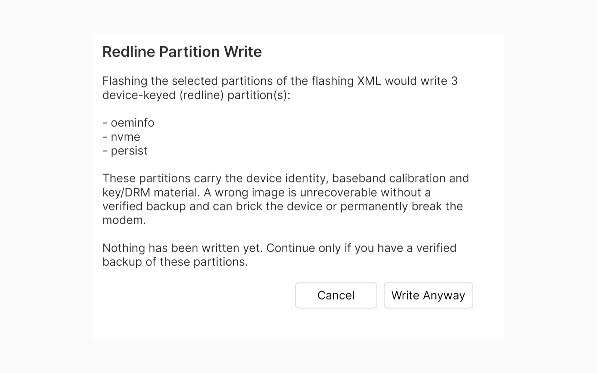
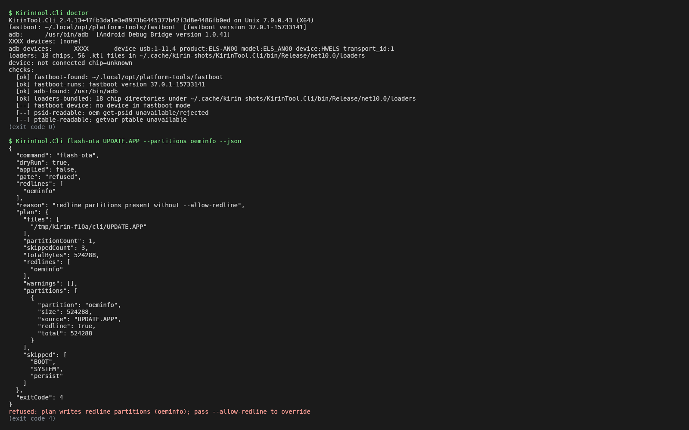

<div align="center">


# Kirin Tool for Linux

**Flash, extract and rescue Huawei Kirin devices from Linux — with a GUI, a headless CLI and an MCP server, all behind the same write-safety gates.**

[](https://github.com/xiaquwan1001/kirin-tool-linux/releases/latest) [](https://github.com/xiaquwan1001/kirin-tool-linux/actions/workflows/release-linux.yml) [](#install) [](LICENSE)

[**Download**](https://github.com/xiaquwan1001/kirin-tool-linux/releases/latest) · [What this fork adds](#what-this-fork-adds-over-upstream) · [Safety model](#safety-model) · [Install](#install) · [CLI & MCP](#cli--mcp-quick-start) · [Docs](#documentation)

</div>

An unofficial, independently maintained Linux port of [Kirin-Tool](https://github.com/kethily-daniel/Kirin-Tool) for Huawei / HiSilicon Kirin devices, built on **.NET 10 / Avalonia**. Current release: **v2.4.13**.

> [!WARNING]
> Flashing, unlocking and rebranding can erase data or damage a device. Back up your data, use firmware matching your device, and read the [safety model](#safety-model) before writing anything. You are responsible for device operations; a successful host build does not establish hardware compatibility.

## 60-second overview

| | |
| :--- | :--- |
| **What it can do** | Extract UPDATE.APP firmware, inspect devices over fastboot/adb, and write Full-OTA / flashing.xml plans through a temporary VCOM loader — from a GUI, a headless CLI or an MCP server (one shared implementation). |
| **What it cannot do** | It cannot guarantee your device is supported (only Kirin 990 5G / P40 Pro is fully verified), it cannot bypass firmware or loader permissions, and plan-only commands (`vcom-unlock`, `oeminfo`, `downgrade-enable`) never write — they only print a plan. |
| **Safety boundaries** | Redline identity/security partitions are refused unless the **human** overrides — `--allow-redline` exists only in the CLI, never over MCP, so an AI client cannot redline-override on its own. Every write reports a machine-readable `gate` (`plan-only`/`refused`/`confirmed`/`applied`) and counts as success only on a device `OKAY`. Pre-op backups are **best effort** — a loader without dump support warns and continues, it never blocks. |
| **Who it is for** | People who drive Huawei devices from scripts or AI agents (CLI + MCP are built for automation) and want every destructive step gated, confirmed and backed up first. Not a one-click repair tool. |

## What this fork adds over upstream

The inherited base is the **Redminote11tech** Linux port of upstream **2.4.8** (see [docs/stable-release.md](docs/stable-release.md) — treat its old install file names as the inherited baseline, not current assets). This fork (`xiaquwan1001`) adds:

| Area | What this fork adds |
| :--- | :--- |
| **Headless CLI + MCP server** | Every tool is also a command (`KirinTool.Cli`) and an MCP tool over stdio (`kirin-tool-cli mcp` / `Kirin-Tool --mcp`); one shared implementation. See [docs/cli-mcp.md](docs/cli-mcp.md). |
| **Real OTA flashing** | `flash-ota` performs a real Full-OTA write through a temporary VCOM loader — verified end to end on a Huawei P40 Pro / ELS-AN00: **46/46 partitions written, device booting 22 s after reboot**. |
| **Redline gates in all three entries** | Device-keyed partitions (`oeminfo`, `nvme`, `modem_secure`, `persist`, `modemnvm*`, `certification`, `hisee_encos`, `veritykey`, …) require an explicit override in the GUI, in the CLI and over MCP. |
| **Honest success reporting** | A fastboot write only counts as successful when the device replies `OKAY` — exit 0 alone no longer hides a rejected write. A temporary loader's "already fastboot unlocked" is reported as *no write*. |
| **Destructive-op confirmations** | Serial-number (NVE) rewrite and FRP erase require an explicit GUI confirmation showing old vs. new values; USB Update re-confirms any redline partitions discovered only after unpacking. |
| **Crash safety net** | Global unhandled-exception handlers log and surface UI crashes instead of dying silently. |
| **Self-published packages** | `.deb`, `.AppImage`, `.tar.gz` and a single-file CLI binary, all built from the same commit and smoke-tested in CI. See [docs/fork-release.md](docs/fork-release.md). |
| **Dual CI** | GitHub Actions + GitLab CI run the same hardware-free test suites; whichever reports first is used. |

## Safety model

**What actually writes to a device:** `flash-ota`, `flash-xml` (CLI/MCP) and the GUI flashing / USB Update / rescue workflows. These are real writes — there is no dry-run after confirmation. `flash-xml` skips identifiers the loader does not expose (with a warning); pass `--strict-names` to refuse instead of skipping (exit 3).

**What never writes:** `vcom-unlock`, `oeminfo`, `downgrade-enable` are plan-only: even with `--yes` they only acknowledge the plan (exit 4, nothing written).

**Redline partitions.** Identity- and security-critical partitions (see list above) are refused unless explicitly overridden:

- **CLI:** requires `--allow-redline`.
- **GUI:** shows a confirmation dialog listing the exact redline partitions.
- **MCP:** does **not** accept `allow-redline` at all — the parameter is rejected with JSON-RPC `-32602` ("redline override is CLI-only"). An AI client cannot redline-override on its own.

**Gate signals.** Every CLI write command with `--json` and every MCP write tool reports a machine-readable `gate` string: `plan-only`, `refused` (with a `reason`), `confirmed` (plan-only acknowledged) or `applied` (real write executed). Clients should branch on `gate`, not just the exit code.

**Battery banner (warning only, by decision).** A read of `battery-soc` / `battery-capacity` (best effort; temporary loaders usually answer `invalid command`) drives a non-modal banner on the device page: below 50% it warns about a mid-write power loss, at or above 50% it stays hidden, and an unreadable level shows one quiet line. **It never blocks a write** — the 50% rule stays a human convention, not a gate.

**Pre-operation backup.** Before any real write (CLI flash-ota / flash-xml, and every GUI write path), Kirin Tool automatically backs up the redline partitions of the write plan plus `ptable` into a timestamped directory (`--backup-dir`, else `$KIRIN_BACKUP_DIR`, else `~/.local/share/kirin-tool/backups/`) and records a `manifest.json` with per-partition file, size, SHA256 and status. The backup is **best effort**: loaders without dump support degrade to a recorded `unsupported` status and a stderr/UI warning — the write is **not** blocked (pass `--require-backup` in the CLI to refuse writes on an incomplete backup, or `--no-backup` to skip it). Existing backup directories are never overwritten.

Unverified hardware behavior stays unverified: see [Verified on hardware](#verified-on-hardware--not-verified).

## Install

Prebuilt files are on the [releases page](https://github.com/xiaquwan1001/kirin-tool-linux/releases/latest); no separate .NET runtime is needed. Exact asset names per release: [docs/fork-release.md](docs/fork-release.md).

| Format | Install |
| :--- | :--- |
| **.deb** | `sudo apt install ./kirin-tool-linux_<ver>_amd64.deb` — self-contained; installs `kirin-tool` (GUI) + `kirin-tool-cli` (CLI/MCP) + udev rules |
| **AppImage** | `chmod +x kirin-tool-linux-<ver>-x86_64.AppImage && ./kirin-tool-linux-<ver>-x86_64.AppImage` (no FUSE2? add `--appimage-extract-and-run`) |
| **tar.gz** | `tar xf kirin-tool-linux-<ver>-x86_64.tar.gz -C ~/opt/kirin-tool-linux && ~/opt/kirin-tool-linux/Kirin-Tool` |
| **CLI binary** | download `kirin-tool-cli-<ver>-linux-x86_64`, `chmod +x`, run — doubles as an MCP stdio server |

If USB access is denied, add yourself to the relevant groups and reconnect:

```bash
sudo usermod -aG plugdev,uucp "$USER"   # Debian/Ubuntu (adbusers on Arch/CachyOS)
sudo udevadm control --reload-rules && sudo udevadm trigger
```

Log out and back in after changing groups. The GUI also shows an **Apply udev rules** notice with copyable commands when usable rules cannot be confirmed. See [docs/portable-appimage.md](docs/portable-appimage.md).

## CLI & MCP quick start

```bash
kirin-tool-cli doctor                                   # what's connected, which fastboot/adb was picked
kirin-tool-cli info                                     # device info, capabilities, rescue plan
kirin-tool-cli extract UPDATE.APP out/                  # extract all partitions
kirin-tool-cli flash-ota base.app --json                # prints the write plan, exits 4 — nothing written
kirin-tool-cli flash-ota base.app --yes                 # REAL WRITE of all non-redline partitions
kirin-tool-cli backup --json                            # read-only dump of identity partitions + manifest
```

`--allow-redline` (CLI only) is required on top of `--yes` if the plan includes redline partitions. Exit codes and the full command table: [docs/cli-mcp.md](docs/cli-mcp.md).

MCP server configuration (newline-delimited JSON-RPC 2.0 over stdio):

```json
{
  "mcpServers": {
    "kirin-tool": {
      "command": "/path/to/kirin-tool-cli",
      "args": ["mcp"]
    }
  }
}
```

MCP tools: `info`, `doctor`, `getvar`, `extract`, `dump`, `backup`, `flash_ota`, `flash_xml`, `vcom_unlock`, `oeminfo`, `downgrade_enable`. Write tools require `confirm: true` and never accept `allow-redline`.

## v2.4.13 highlights

- **MCP contract matches reality**: `flash_ota` / `flash_xml` are documented as real writes, plan-only tools stay plan-only — and it cannot drift again (generated from `CliWriteKind`). Full notes: [docs/release-notes/v2.4.13.md](docs/release-notes/v2.4.13.md).
- **MCP cannot redline-override**: `allow-redline` over MCP is rejected with JSON-RPC `-32602`; the override stays CLI-only.
- **No more false successes**: GUI fastboot writes require exit 0 **and** a device `OKAY` (XML partitions, Full OTA, rescue); refusals emit a single machine-readable `gate` document.
- **Automatic pre-op backup** before every real write: redline partitions of the plan plus `ptable` go into a timestamped directory with a SHA256 `manifest.json` — best effort, with `--require-backup` / `--no-backup` / `--backup-dir` controls and a read-only `backup` command.
- **Low-battery banner** on the device page (below 50%) is a warning only — it never blocks a write.
- **flash-xml honesty**: identifiers the loader does not expose are skipped with a warning; `--strict-names` refuses instead (exit 3).
- **17 hardware-free test harnesses** (new: WriteGates, McpProtocol, OtaPlan, PreOpBackup) run in dual CI (GitHub Actions + GitLab CI).

## Screenshots

All six are headless renders of the v2.4.13 UI (`v2.4.13`, commit `47fb3da`), captured from the real
Avalonia controls — no upstream or older-release images. Capture details and per-file provenance:
[docs/screenshots.md](docs/screenshots.md). No device was connected for these captures, so device fields
show the UI's native "Not Read" state.

| Main window (light) | Main window (dark) |
| :-- | :-- |
|  |  |

| UPDATE.APP extractor | Flash progress (pre-op backup line at the bottom) |
| :-- | :-- |
|  |  |

| Redline confirmation | CLI / MCP output |
| :-- | :-- |
|  |  |

## Verified on hardware / Not verified

| Verified on hardware | Not verified |
| :--- | :--- |
| **Huawei P40 Pro (ELS-AN00)**: `flash-ota` through a temporary VCOM loader — 46/46 partitions written, device boots ~22 s after `fastboot reboot` | Other devices and chipsets (Kirin 980 / 9000 evidence exists from earlier work, but no full OTA run) |
| Device information, fastboot reads and extraction flows on the same device | BD-package gzip SUPER images (merger path not validated on hardware) |
| Kirin 990 5G loader families used by the ELS-AN00 rescue flow | Kirin 990 4G (**unsupported** — do not substitute 5G loaders), Kirin 9000 rescue writes (device-rejected), hardware USB Update equivalence |

Limits of the native fastboot engine and the Mate 40 Pro rescue investigation: [docs/native-fastboot-parity-v2.4.5.md](docs/native-fastboot-parity-v2.4.5.md), [docs/mate40-bootloader-analysis.md](docs/mate40-bootloader-analysis.md).

## Features

| Tool | What you can do |
| :--- | :--- |
| **UPDATE.APP Extractor Tools** | Open Base, Cust or Preload firmware, view every archive entry, tick partitions, choose an output folder. No phone needed. |
| **Huawei fastboot** | Bundled native AOSP-based client with reconstructed Huawei dump/upload, memory, UFS-eye and UltraFlash extensions; staging/fetch, slots, fastbootd, logical partitions, image plans. No Wine. |
| **Device information** | Model, vendor/country, lock state, firmware versions; NVE SN and OEM SN / PSID as separate queries. |
| **Firmware and loader workflows** | Flash, dump, rebrand and bootloader-unlock workflows on supported devices, subject to firmware permissions and loader requirements. |
| **USB Update** | Linux userspace libusb transport, no DKMS module. See [docs/usb-update-userspace.md](docs/usb-update-userspace.md). |
| **Portable desktop app** | AppImage with .NET runtime and libusb bundled; reusable **Apply udev rules** notice. |

Full feature details: [docs/features.md](docs/features.md).

## Documentation

| Guide | Details |
| :--- | :--- |
| [Docs index](docs/INDEX.md) | All guides in one table. |
| [CLI & MCP](docs/cli-mcp.md) | Commands, gates, exit codes, MCP protocol details. |
| [Fork release pipeline](docs/fork-release.md) | Assets, deb layout, dependency policy, releasing. |
| [Fork provenance](docs/FORK-NOTICE.md) | License position and upstream relationship. |
| [UPDATE.APP extraction](docs/partition-extractor.md) · [AppImage & udev](docs/portable-appimage.md) · [Native fastboot parity](docs/native-fastboot-parity-v2.4.5.md) | Inherited-baseline guides. |

### Build from source

Install the **.NET 10 SDK** and the [native build prerequisites](fastboot-modern/README.md), then:

```bash
git clone https://github.com/xiaquwan1001/kirin-tool-linux.git
cd kirin-tool-linux
./packaging/publish.sh publish-out
./publish-out/Kirin-Tool
```

### Issues

[Open an issue](https://github.com/xiaquwan1001/kirin-tool-linux/issues) with the app version, distribution, device model/chipset, firmware, connection mode, attempted operation and relevant error lines. Redact serial numbers, PSIDs, IMEIs and other private identifiers before sharing logs.

## Credits and license

This Linux fork derives from upstream **v2.4.2**, distributed under BSL 1.1, and is maintained independently by **[Redminote11tech](https://github.com/Redminote11tech)** (the Linux port this repo forks from). It does not sync newer upstream source. Original copyright notices are retained.

- **Kethily Daniel & NDXCode** — original Kirin-Tool authors.
- **[TASZK Security Labs SL](https://taszk.io)** — head resend bootrom exploit.
- **[kasnria001](https://github.com/kasnria001)** — decrypted xloaders and community help.
- **Redminote11tech** — Linux port and maintenance (upstream of this fork).
- **[xiaquwan1001](https://github.com/xiaquwan1001)** — this fork: CLI/MCP, `flash-ota`, redline gates, packaging and CI.

The [LICENSE](LICENSE) is authoritative: **BSL 1.1**, no Additional Use Grant, changing to **GPL-3.0-or-later** after each version's four-year Change Date. Read the license before copying, modifying or using the software; production use is restricted until the applicable Change Date. Bundled third-party components retain their own licenses; corresponding native sources accompany releases. Details: [docs/FORK-NOTICE.md](docs/FORK-NOTICE.md).

<details>
<summary><strong>Support the original authors</strong></summary>

Donate through [Ko-fi](https://ko-fi.com/kirintool), or use the original authors' cryptocurrency addresses:

BTC: `bc1q70khwtwdp0jtpvfmct4gu8ktktzv5rurk0kdky`

ETH: `0xF7585F5d27bB7f10558a99CBa53459Be1969b090`

LTC: `ltc1qmyuy4vqevmszxjpl3dqdtkqpg7fper5vw48ulz`

SOL: `4CrT7dSL6kTCkJU4Fu4DT1LisU4rLFwbpE5GFS5wdEcR`

USDT SPL(SOL): `4CrT7dSL6kTCkJU4Fu4DT1LisU4rLFwbpE5GFS5wdEcR`

USDT Tether (TRC20): `TD2sJbEmYa93sJhDBmTrvqmScqQSVTCfCK`

</details>

---

*Independent community software, unaffiliated with Huawei or HiSilicon and not sponsored or endorsed by the original Kirin-Tool authors. Huawei, HiSilicon and Kirin names and trademarks belong to their respective owners.*
