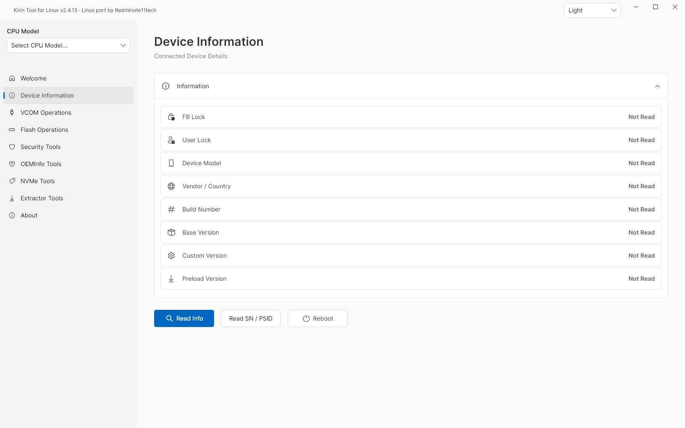
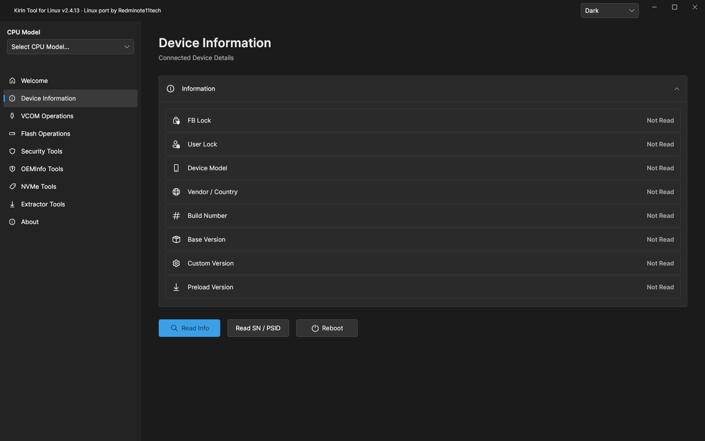
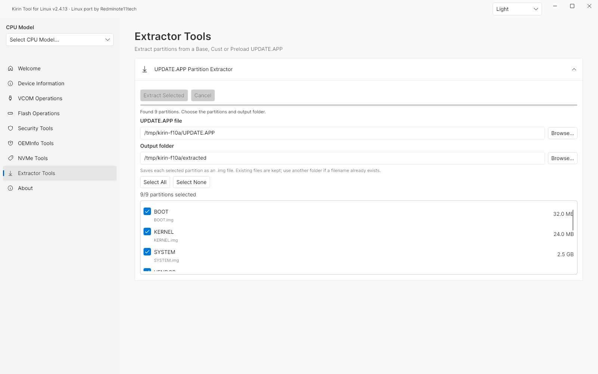
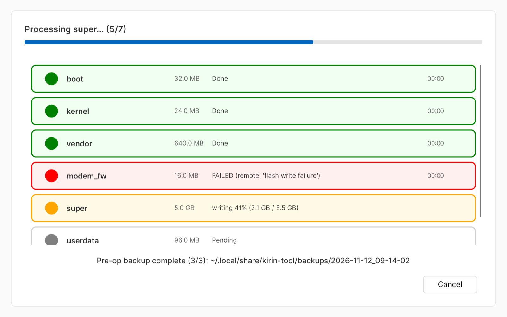
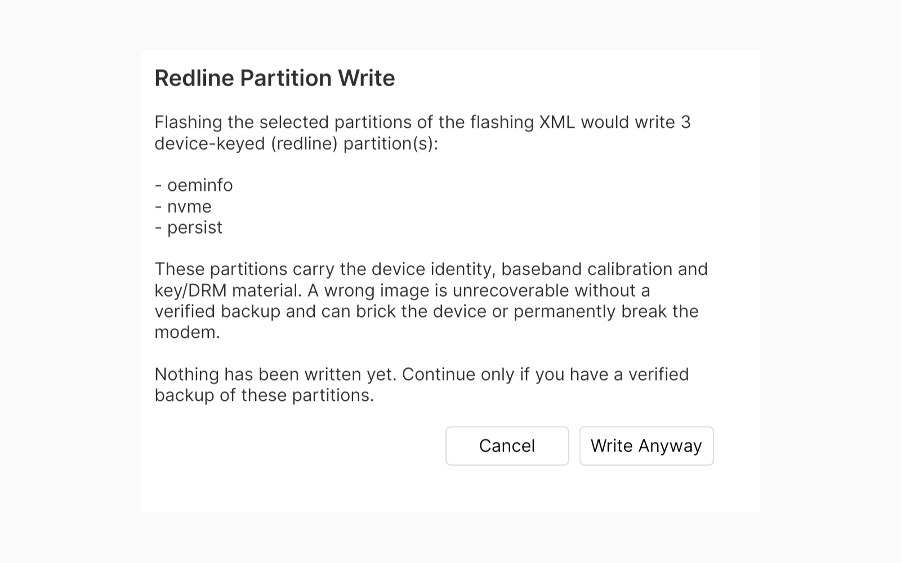
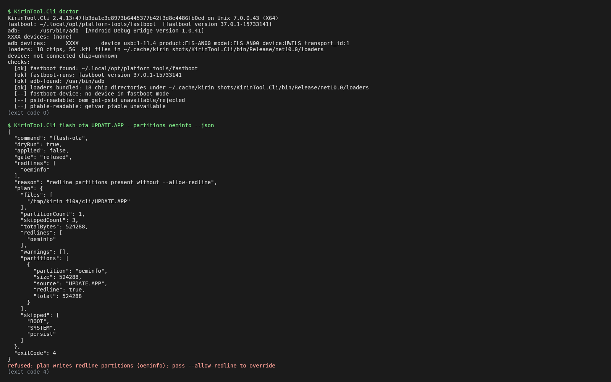

# 麒麟刷机工具 for Linux · refresh

**[English](README.md)** · [简体中文](README.zh-CN.md)

**在 Linux 上操作华为/海思麒麟设备：解包 UPDATE.APP、华为同构 fastboot 引擎、真机 Full-OTA 刷写——
GUI、无头 CLI 与 MCP server 共用同一份实现，每一个破坏性操作都先过闸门、先确认、先备份。**

[](https://github.com/xiaquwan1001/kirin-tool-linux-refresh/releases/latest)
[](https://github.com/xiaquwan1001/kirin-tool-linux-refresh/actions/workflows/release-linux.yml)
[](#安装)
[](LICENSE)

[**下载**](https://github.com/xiaquwan1001/kirin-tool-linux-refresh/releases/latest) ·
[为什么叫 -refresh](#为什么这个仓库叫--refresh) ·
[相对上游改了什么](#这条线相对上游改了什么) ·
[设计取舍](#值得争论的设计取舍) ·
[刷机实操记录](#实操记录刷一台麒麟设备到底长什么样) ·
[安全模型](#安全模型) · [安装](#安装) · [CLI 与 MCP](#cli-与-mcp-快速开始) · [文档](#文档)

> [!WARNING]
> 刷机、解锁、改串都可能清空数据甚至让设备再也起不来。宿主机上编译成功，不能证明你的机型可用。
> 动手前请备份、确认固件与型号匹配，并先读[安全模型](#安全模型)。设备操作的责任在你。

本仓库首先是**技术记录**：这条维护线相对上游 Linux 移植改了哪些东西、每处改动为什么存在、
我们在一台麒麟 990 5G 设备上用 Linux 刷机时究竟观察到了什么。偏实用、偏展示向的内容发在酷安，
不在这里。

---

## 为什么这个仓库叫 `-refresh`

代码血缘有三层，其中两层同名：

| | 项目 | 是什么 |
| :--- | :--- | :--- |
| 最初上游 | [kethily-daniel/Kirin-Tool](https://github.com/kethily-daniel/Kirin-Tool) | 原版 Windows/WPF 工具，v2.4.2 时为 BSL 1.1 |
| 本仓库的父仓库 | [Redminote11tech/kirin-tool-linux](https://github.com/Redminote11tech/kirin-tool-linux) | 把 v2.4.2 独立移植到 Linux 的 Avalonia 版本 |
| **本仓库** | `xiaquwan1001/kirin-tool-linux-refresh` | 上述移植的**refresh 维护线** |

后缀不是为了好看，有三个理由：

1. **不加后缀就分不出来。** 父仓库本身就叫 `kirin-tool-linux`，同名 fork 在搜索、链接、发布页里
   完全无法区分「该克隆哪个、该装哪个 release」。
2. **它是分叉线，不是镜像。** 上游在 2026-09-11 把 BSL 1.1 换成了只读的 *Kirin-Tool Read-Only
   Reference License*，这条线**自此停止同步上游**。之后所有构建都是在 BSL 时代的 v2.4.2 基线上
   我们自己写的代码——把它称作「上游镜像」是事实错误。来源与许可立场记录在
   [docs/FORK-NOTICE.md](docs/FORK-NOTICE.md)。
3. **「refresh」就是实际发生的事。** 这条线被完整重审（写入路径、MCP 契约、GUI 成功判定、打包），
   在真机上重新验证，并配了自己的发布流水线。名字应当反映这一点。

渠道分工在此写清楚：**本仓库是技术门面（改动、理由、真机发现、诚实的边界）**，酷安帖子是实用展示
（能干什么、怎么用更省事）。两者若有冲突，以本仓库为准。

## 这条线相对上游改了什么

基线 = 接手时那个「上游 v2.4.2/v2.4.8 的 Avalonia 移植」。下表是之后新增/修改的内容，
逐版本明细见 [docs/refresh-changelog.md](docs/refresh-changelog.md)。

| 改动 | 为什么存在 |
| :--- | :--- |
| **CLI 与 MCP server 是一等入口**（`kirin-tool-cli`、`Kirin-Tool --mcp`），与 GUI 共用同一个 `CliRunner` | 刷机已经可以脚本化、可以由 agent 驱动；三套代码一周内必然漂移。一份实现，三张面孔。 |
| **`CliWriteKind` 生成所有契约文案**（MCP `initialize.instructions`、每个工具的 `confirm` 描述、CLI 帮助） | 早期版本把 `flash_ota` 描述成「gate-only in this build」，而它真的在写设备。生成的文案无法与实现漂移。 |
| **机器可读的 `gate`**：`plan-only` / `refused` / `confirmed` / `applied`，且拒绝时**只输出一份** JSON | 客户端原先只能看退出码，而 4 同时表示「未确认」和「被拒绝」；拒绝路径输出了两份 JSON，直接打爆解析器。 |
| **红线覆盖只在 CLI**：MCP 传 `allow-redline` 返回 JSON-RPC `-32602` | 身份/安全分区（`oeminfo`、`nvme`、`persist`、`modem_secure`、`modemnvm*`、`certification`、`hisee_encos`、`veritykey`…）实际上不可逆。由人来敲覆盖，AI 客户端不能给自己授权。 |
| **成功 = 退出码 0 **且**设备回 `OKAY`** | 设备拒绝的写入，过去因为进程退出 0 而显示「刷写完成」。现在临时 loader 说的「already fastboot unlocked」只会被记成*未写入*。 |
| **SN（NVE）重写与 FRP 清除必须弹窗确认新旧值**；USB Update 对解包后才发现的红线分区二次确认 | 这些操作过去离「静默执行」只差一次误点；解包可能暴露预检根本没看到的分区。 |
| **写入前自动备份**（计划中的红线分区 + `ptable`，时间戳目录 + `manifest.json` 记录大小/SHA256/状态） | 最容易后悔的那次写入，恰恰是撤不回来的那次。参数见下。 |
| **低电量横幅（仅警告）** | 见[为什么电量只是警告](#为什么电量只是警告不是闸门)。 |
| **`flash-xml` 默认跳过 loader 未暴露的标识符**（仅警告），`--strict-names` 才拒绝（exit 3） | 人手写的 XML 可能合法地写了只在某些 loader 上成立的别名；默认硬拒没有拦住任何真实风险，只让人困惑。 |
| **VCOM 只有一份实现，GUI 与 CLI 共用**（`vcom-unlock` 已能真上传；`oeminfo`、`downgrade-enable` 仍恒 exit 4） | loader 装载协议原来只有 GUI 路径，同一次解锁只能手点界面。现在 CLI/MCP 直接调 `FirmwareUnlocker`/`VcomFlasher`：同样的帧、同样的地址表，外加可注入的 ACK 策略与会话日志（[对齐表](docs/cli-vcom-unlock-parity.md)）。oeminfo 的 HMAC 仍无法离线重算，所以它保留"只出计划"。 |
| **自建发布流水线**（deb / AppImage / tar.gz / 单文件 CLI 同源于一个提交），deb 依赖策略 + 三个 Ubuntu 代的 `apt-get -s` 模拟 | 上游 release 从不匹配 Linux 运行时现实：ICU soname 每个发行版都变、24.04+ 的 `libssl3` 变成 `libssl3t64`、dpkg alternatives 不支持通配。详见 [docs/fork-release.md](docs/fork-release.md)。 |
| **双 CI + 测试单一事实源**（`tests/suites.txt`，17 套免硬件 harness，GitHub Actions 与 GitLab CI 同跑） | 只有一条流水线跑的测试，注定会烂。`FlashPolicy` 现在缺 CLI 二进制就硬失败，不再静默 SKIP。 |
| **`StableParity` 哈希冻结面**：`loaders/`、fastboot payload、`SuperMerger`、`VcomFlasher`、USB Update | 硬件 blob 与串口协议不允许被顺手改掉；这些位置只接受行为保持型改动。 |
| **崩溃兜底与健壮性修复**（超时杀进程树、`SerialPort` 泄漏、每实例临时文件、截断的 sparse 头直接拒绝） | 刷机中途静默消失的 GUI，比会报错的 GUI 危险得多。 |

## 值得争论的设计取舍

**备份是尽力而为，不是闸门。** 临时 VCOM loader 对 `oem dump-emmc` / `oem dump-storage` 通常回
`invalid command`——而这恰好是 ELS-AN00 上唯一能走通的那条刷写路径所用的 loader。把「备份不完整」
设成硬闸门，等于把唯一可行的路径堵死，然后所有人永久加上 `--no-backup`。于是：降级、逐分区记录
`unsupported`/`failed` 与原因、stderr/UI 警告，同时给需要严格模式的人 `--require-backup`。
代价是：忽略警告就会静默——所以 manifest 记录的是每个分区的状态，而不是一句「备份完成」。

**MCP 路径没有 dry-run，但依然无法红线覆盖。** 伪造 dry-run 就是当年「gate-only」那个谎言的翻版。
现在的契约写得很直白（「`confirm: true` 执行真实写入；MCP 路径没有 dry-run」），红线拒绝是结构性的
而非策略性的，每次调用都返回可分支的 `gate`，客户端不必去解析散文。

**`flash-ota` 与 `flash-xml` 对未知标识符的默认行为不同**——前者跳过、后者警告后跳过（`--strict-names`
才拒绝）。OTA 的计划来自固件包：loader 认不出的标识符意味着固件/loader 代际不匹配，你应该看见它。
XML 计划是人写的，可能合法使用了只在部分 loader 上成立的别名；在那里默认硬拒会毙掉正当配置。

**电量是警告，不是闸门。** 电量读取本身是尽力而为（临时 loader 常回 `invalid command`），建立在
不可靠读数上的闸门，要么拦住一切，要么什么也保护不了。于是 50% 仍是人的规矩，以非模态横幅提示，
读不到时如实显示「读不到」，而不是编一个百分比。

**原生 fastboot 引擎不是可选项。** Google platform-tools 37 对华为 loader 大面积失败
（`getvar partition-size` 之类全挂），捆绑的华为同构客户端是唯一能和这些设备对话的东西；
它重建了什么、测了什么、哪些确实没验证，写在
[docs/native-fastboot-parity-v2.4.5.md](docs/native-fastboot-parity-v2.4.5.md)。

## 实操记录：刷一台麒麟设备到底长什么样

以下全部来自一台华为 P40 Pro（ELS-AN00，麒麟 990 5G）在 Linux 上的实践，也是安全模型长成这样的原因。

| 现象 / 想当然 | 真实情况 |
| :--- | :--- |
| 「fastboot 能看到设备，工具坏了」 | `18d1:d00d` 可能是一个 *临时* fastboot，只在 BootROM 注入后存在于内存里，`reboot` 就消失。它不是一台能开机的手机。 |
| `oem unlock` 回「already fastboot unlocked」 | 在临时 loader 上毫无意义。解锁只能发生在板级（BD）bootloader 上；零售 bootloader 只回 `invalid command`。而 `oem get-bootinfo` 报 `unlocked` 也是假象——只有写探针能验真。 |
| 「loader 打印了分区表，直接脚本化」 | 临时 loader 公布 90 项、含工厂项却没有 `kpatch`；真实 GPT 是 74 项。永远不要拿 loader 的 ptable 当分区图。 |
| 「我逐分区刷完了，等价于 Full-OTA」 | 不等价：Full-OTA 还带 `ptable`、官方 `userdata`/`cache` 骨架与版本元数据。请用 `flash-ota`。 |
| 「包能解出来，计划就没问题」 | base `UPDATE.APP` 的 SUPER 是**两段 sparse**，必须合并；只取大的那段会写进去约 2.1 GiB 的零，必然黑屏。 |
| 「GUI 能刷，BD 包应该也行」 | BD 包可能带 **gzip 压缩的** SUPER。CLI 会识别 `0x1f8b` 魔数并解压，GUI 的合并路径还没做，表现是 45/46 半刷。已知缺口，见下。 |
| 「跨版本没事，反正 GPT 都是 74 项」 | 都是 74 项没错——但 `boot` 25→30 MB、`super` 6728→6992 MB、`kpatch` 66→61 MB、`preas` 296→32 MB。先写 `ptable`。 |
| 「新 xloader 混着我手上那个 loader 一起用」 | 启动链套件必须同代，混代的结果是全黑、零枚举，或 `load hhee failed`。`12d1:3609` 间歇性出现即启动链失败；恢复只能人肉短接——没有软件 EDL 出口。 |
| 「改 oeminfo 里的 `Display_Version` 就能绕过版本校验」 | `oeminfo` 是 96 MiB 稀疏、32 B 对齐的 section，HMAC 用设备密钥，无法离线重算。这也是 `oeminfo` 命令在 CLI/MCP 里只做规划的原因；真要把镜像写进设备是 `oeminfo-flash`（红线、不可逆、需手输确认串）。 |
| 「串口打不开，肯定是权限」 | `12d1:3609` 配 `option` 驱动时 pyserial 会报 `errno 71`（DTR stall）。可用做法是裸 `os.open` + termios 8N1，全程不碰 DTR/RTS。BootROM 半截会话（发了 HEAD 没传数据）之后所有字节全零——拔线、长按电源 15 s、重新短接，别去「修」帧格式。 |
| 「刷到 60% 挂了，工具的问题」 | 先看电量：写入中掉电在这类设备上不可恢复。保持 ≥50%，工具只警告不拦。 |

唯一值得引用的端到端结果：经临时 VCOM loader 在 ELS-AN00 上执行 `flash-ota` →
**46/46 分区 OKAY，重启后约 22 秒进系统**。

## 安全模型

**会写设备：** 9 条写能力（`flash-ota`、`flash-xml`、`reboot`、`write-sn`、`frp-remove`、
`unlock-bootloader`、`usb-testpoint`、`reboot-usb-update`、`oeminfo-flash`），**GUI / CLI / MCP 三个入口都有，
且都过同一个审批闸门**。
确认之后没有 dry-run。`flash-xml` 跳过 loader 未暴露的标识符，`--strict-names` 则拒绝（exit 3）。

**只写内存、不碰分区：** `vcom-unlock` —— 经 VCOM BootROM（`12d1:3609`）装载 loader 链，与 GUI 的
「Unlock Fastboot」同一实现。需要 `--yes`；`--dry-run` 保持旧的只出计划。hi9xx 在 `null` 与 `XLOADER`
之间必须人工拔插：用 `--replug wait:<秒>`，或拆成 `--stage-only null` 再 `--stage-only rest`
（`rest` 绝不重发 START）。

**永不写设备：** `oeminfo`（只在宿主机上生成镜像）、`downgrade-enable` —— 只出计划，即便加了
`--yes` 也 exit 4。把转换结果真正写进设备是**另一条能力** `oeminfo-flash`（红线、不可逆、手输确认串；
MCP 需在运行中的 GUI 里带外批准）。

**会话日志（GUI 与 CLI 同一份）：** 每次 VCOM 尝试写
`~/.local/state/kirin-tool/vcom-<UTC>-<cpu>.log`（可用 `KIRIN_LOG_DIR` 覆盖）：pid、端口、framing、
逐帧一行（type/addr/len/seq/bytes）、ACK 原始字节或超时、每阶段起止、每条拔插提示与用户选择、
最终结论——事后可对账。GUI 在进度对话框显示路径，CLI 打到 stderr。字段表见
[docs/cli-vcom-unlock-parity.md §7](docs/cli-vcom-unlock-parity.md)。

**红线分区 / 不可逆写入** 必须由人显式覆盖，而且**不是点一下按钮就算**：
- GUI：弹窗逐项列出真实 argv 与将被写的分区；红线或不可逆项用红字标出，并要求手输
  `I UNDERSTAND <能力 id>` 才解锁「Approve once」；另有「Approve for this session」。
- CLI：`--yes`，红线项再加 `--allow-redline`，**并且**要在交互式 stdin 上键入同一个确认串；
  stdin 非交互（脚本/CI）直接拒绝并 exit 4，提示改用 GUI 批准。
- MCP：`confirm:true` 只是「调用方知道这不是 dry-run」，**永远不足以放行**——请求会被推给正在运行的
  GUI 弹窗，请人在那里批准；GUI 没在跑就返回 `{"error":{"code":"approval_required_human"}}` 并让你改用 CLI。
  红线覆盖参数 `allow-redline` MCP 一律不接受（`-32602`）。

**AI 发起的写操作怎么批准（重要）。** 让 agent 通过 MCP 发起写操作时，先在这台机器上把 GUI 打开：
agent 的请求会以审批弹窗的形式出现在 GUI 里，弹窗写明发起方是 `mcp`、真实命令和副作用，由人点批准
（红线项还要手输确认串）。GUI 不在跑时 agent 只会拿到 `approval_required_human`，不会静默写入。
每一次批准/拒绝都写一行审计：`~/.local/state/kirin-tool/approvals.jsonl`（可用 `KIRIN_APPROVAL_AUDIT` 改路径）。
完整设计见 [docs/approval-gate.md](docs/approval-gate.md)。

**闸门信号。** 所有写命令的 `--json` 与所有 MCP 写工具都返回 `gate`：`plan-only`、`refused`（带
`reason`）、`confirmed`（确认了计划但未写）、`applied`（设备接受了写入）、`partial`（多步写入只有一部分
成功，exit 3）、`failed`/`unconfirmed`（`applied:false` + `reason`，绝不算成功）。`applied` 一律来自设备侧
结果，没有默认值（[write-verdict-parity.md](docs/write-verdict-parity.md)）。`write-sn` 另带
`verified`/`expected`/`readBack`，只有读回一致才 exit 0。请按 `gate` 分支，不要只看退出码。
退出码：0 成功 / 1 用法 / 2 无设备 / 3 设备拒绝（含 `--strict-names`）/ 4 闸门拒绝 / 5 文件或校验失败。

**写入前备份。** 第一次真实写入之前，把计划中的红线分区与 `ptable` dump 进带时间戳的目录
（`--backup-dir`，否则 `$KIRIN_BACKUP_DIR`，否则 `~/.local/share/kirin-tool/backups/`），并写
`manifest.json`（工具版本、UTC 时间、fastboot 路径、可读到的型号/SN、触发命令、写入计划，以及每个
分区的文件/大小/SHA256/状态）。已有备份目录绝不覆盖。`--require-backup` 把「备份不完整」变成拒绝，
`--no-backup` 跳过；另有只读的 `backup` 命令可按需执行。

没验证过的行为就是没验证过——见[真机验证边界](#真机已验证--未验证)。

## 安装

预编译产物在[发布页](https://github.com/xiaquwan1001/kirin-tool-linux-refresh/releases/latest)，不需要
另装 .NET 运行时。资产名、deb 布局与依赖策略见 [docs/fork-release.md](docs/fork-release.md)。

| 格式 | 安装 |
| :--- | :--- |
| **.deb** | `sudo apt install ./kirin-tool-linux_<ver>_amd64.deb` —— 自包含，装 `kirin-tool`（GUI）+ `kirin-tool-cli`（CLI/MCP）+ udev 规则 |
| **AppImage** | `chmod +x kirin-tool-linux-<ver>-x86_64.AppImage && ./kirin-tool-linux-<ver>-x86_64.AppImage`（没有 FUSE2 就加 `--appimage-extract-and-run`） |
| **tar.gz** | `tar xf kirin-tool-linux-<ver>-x86_64.tar.gz -C ~/opt/kirin-tool-linux && ~/opt/kirin-tool-linux/Kirin-Tool` |
| **CLI 单文件** | 下载 `kirin-tool-cli-<ver>-linux-x86_64`，`chmod +x` 后直接跑——同时就是 MCP stdio server |

资产与包名刻意保留历史字符串 `kirin-tool-linux`：改仓库名不应顺手改 deb 包名（那会破坏升级路径）。

USB 没权限就加组后重连：

```bash
sudo usermod -aG plugdev,uucp "$USER"   # Debian/Ubuntu（Arch/CachyOS 用 adbusers）
sudo udevadm control --reload-rules && sudo udevadm trigger
```

## CLI 与 MCP 快速开始

```bash
kirin-tool-cli doctor                                   # 连了什么、选中的 fastboot/adb 是哪个
kirin-tool-cli info                                     # 设备信息、能力与救援计划
kirin-tool-cli extract UPDATE.APP out/                  # 解出全部分区
kirin-tool-cli flash-ota base.app --json                # 只打印计划，gate=plan-only，exit 4
kirin-tool-cli flash-ota base.app --yes                 # 真写全部非红线分区
kirin-tool-cli backup --json                            # 只读 dump 身份分区 + manifest
kirin-tool-cli partitions --json                        # 设备分区表（GUI 分区选择器同源）
kirin-tool-cli psid --json                              # 设备标识（oem get-psid）
kirin-tool-cli capabilities                             # 逐芯片能力矩阵 + rescue 计划（不需设备）
kirin-tool-cli udev                                     # 宿主机 udev 规则覆盖（缺则打印修复命令）
kirin-tool-cli vcom-unlock --cpu hisi990 --json         # 只打印 loader 装载计划，exit 4
kirin-tool-cli vcom-unlock --cpu hisi990 --yes          # 真上传（设备需已在 VCOM 模式）
kirin-tool-cli vcom-unlock --cpu hisi990 --yes --stage-only rest   # 人工拔插之后续跑```

MCP server（换行分隔 JSON-RPC 2.0 over stdio）：

```json
{
  "mcpServers": {
    "kirin-tool": {
      "command": "/path/to/kirin-tool-cli",
      "args": ["mcp"]
    }
  }
}
```

工具清单（22 个，1:1 由 CLI 命令表的 `McpName` 生成，没有第二份实现）：

| 类型 | 工具名 |
| :--- | :--- |
| 只读（10） | `info`、`doctor`、`getvar`、`extract`、`dump`、`backup`、`partitions`、`psid`、`capabilities`、`udev` |
| 真实写入（9） | `flash_ota`、`flash_xml`、`reboot`、`write_sn`、`frp_remove`、`unlock_bootloader`、`usb_testpoint`、`reboot_usb_update`、`oeminfo_flash`（要求 `confirm: true` **且**在运行中的 GUI 里由人再批一次；没有 dry-run） |
| 仅规划（3） | `vcom_unlock`、`oeminfo`、`downgrade_enable`（`confirm: true` 也只确认计划，exit 4） |

只读工具共 10 个（`info`…`udev`）、写工具共 12 个（9 真实写入 + 3 仅规划）；写工具一律要求
`confirm: true`，永不接受 `allow-redline`，且 `confirm` 之后仍要人工带外批准（见[安全模型](#安全模型)）。GUI/CLI/MCP 三面的一致性与漂移门禁见
[docs/parity-design.md](docs/parity-design.md)，完整命令表与闸门语义见 [docs/cli-mcp.md](docs/cli-mcp.md)。

## 截图

v2.4.13 界面的 headless 渲染（commit `47fb3da`，来自真实 Avalonia 控件）；没有连接设备，所以设备字段
是界面原生的 "Not Read" 状态。逐文件来源见 [docs/screenshots.md](docs/screenshots.md)。

| 主界面（浅色） | 主界面（深色） |
| :-- | :-- |
|  |  |

| UPDATE.APP 提取器 | 刷写进度（底部是写入前备份行） |
| :-- | :-- |
|  |  |

| 红线确认 | CLI / MCP 输出 |
| :-- | :-- |
|  |  |

## 什么时候会显示『未验证』

工具把两件事分开报：**「字节/命令发出去了」（`applied`）** 和 **「设备侧确认收下了」（`verified`）**。
只有后者成立才会说成功。下表是全部会出现「未验证」的地方：

| 场景 | 结论 | 怎么变成"验证过" |
| :--- | :--- | :--- |
| VCOM loader 上传（GUI 进度窗 / `vcom-unlock`）有帧没拿到 `0xAA` ACK | GUI 琥珀色 **"Uploaded — Unverified"** + `frames sent / ACKed / missing`；CLI `gate=applied-unverified`, `reason=ack_missing:<n>` | 换线/换口重跑；或加 `--require-ack` 让它直接失败（exit 3） |
| `--ack-mode off`（从不读 ACK） | `verified=false`, `reason=ack_not_requested` | 用默认 lenient 或 strict |
| loader 缺失或无法 DTL 解密 | 直接在**发第一帧之前**失败：`failureKind=missing-loader`, `framesSent=0`，exit 5 | 补齐 `loaders/<chip>/*.ktl` |
| 写 NVE 序列号（GUI NVMe▸Write SN） | 只有写后 `getvar nve:SN` 读回一致才报成功；否则弹 **"Write Not Confirmed"** 并附读回值与原因 | 读回值正确即成功；不一致重试 |
| `--require-backup` 但备份目录建不出来 / dump 不完整 | 拒绝写入：exit 4，`reason=require_backup_failed`，stderr 给出原因 | 修好备份目录/权限后重跑 |
| 选项拼错（如 `--require-backu`） | exit 1 并指名未知选项（不再被当成无害 flag 静默吞掉） | 用 `--help`；确实需要旧行为时加 `--lenient-args` |

默认（不带 `--require-ack`）的"未验证"退出码仍是 0：`applied` 描述的是"已写出"这一事实，
闸门契约与 35c6f6b 保持一致；**要把它当失败处理就加 `--require-ack`**。完整判定模型见
[docs/verdict-honesty.md](docs/verdict-honesty.md)。

## 真机已验证 / 未验证

| 真机已验证 | 未验证 |
| :--- | :--- |
| **华为 P40 Pro（ELS-AN00）**：经临时 VCOM loader 执行 `flash-ota` —— 46/46 分区写入，重启后约 22 秒起机 | 其他机型与其他麒麟 SoC（Kirin 980 / 9000 有早期工作的证据，但没有跑过完整 OTA） |
| 同一台设备上的设备信息、fastboot 读取与解包流程 | BD 包的 gzip SUPER 镜像（GUI 合并路径未在真机验证） |
| ELS-AN00 救援流程所用的麒麟 990 5G loader 家族 | 麒麟 990 4G（**不支持**——不要拿 5G 的 loader 硬顶）、麒麟 9000 的救援写入（设备侧拒绝）、硬件级 USB Update 等价性 |

## 已知缺口

- GUI 侧缺少 gzip SUPER 处理（CLI 已有）→ BD 包可能停在 45/46 半刷。
- 临时 loader 上电量读取不可靠；50% 仍需人自己守。
- `VcomOpenProbe` / `UsbUpdateProbe` 因需要真实 USB 硬件而不进 CI；`VisualParity` 因依赖字体像素差也不进。
- 只有一个机型跑过完整 OTA。

## 日志在哪、怎么读

每次设备操作写两份日志，互不替代：

| 类型 | 位置 | 内容 |
| :--- | :--- | :--- |
| 结构化（新） | `${KIRIN_LOG_DIR:-~/.local/state/kirin-tool}/{vcom,fastboot,flash}/` 下 `<UTC时间戳>-<pid>.jsonl`，**一个操作一个文件**，目录 `0700`、文件 `0600` | 每行一个 JSON：`ts/pid/op/phase/tool/argv/exitCode/durationMs/stdoutTail/stderrTail/ok/verdictSource/notes` |
| 人读文本（原有） | `<安装目录>/log/kirintool_log_*.log`，不可写时 `${XDG_STATE_HOME:-~/.local/state}/Kirin-Tool/log/` | 与以前一致，只有 fastboot 命令才写 |

常用读法：

```bash
# 最近一次 fastboot 操作到底怎么判的
ls -t ~/.local/state/kirin-tool/fastboot/*.jsonl | head -1 | xargs cat | jq -c '{op,phase,ok,verdictSource,exitCode}'

# 所有失败操作，只看证据尾部和判据
jq -c 'select(.phase=="result" and .ok==false) | {op,verdictSource,stderrTail}' \
  ~/.local/state/kirin-tool/*/*.jsonl | head -20

# 某个分区最近有没有真写成功
grep -l '"op":"fastboot.flash"' ~/.local/state/kirin-tool/fastboot/*.jsonl | tail -3
```

要点：

- `ok` 旁边永远有 `verdictSource`（`exit-code` / `arg-validation` / `timeout` / `output-contains:OKAY` …）——失败能被追溯到具体一行输出，而不是只有一个布尔值。
- argv 已脱敏：`--password xxx` 记成 `--password ***`，调用方自定义的解锁码记成 `***(16)`；厂商固定口令 `UUUU…` 仍是公开常量，照原样记录。
- 想换目录：`KIRIN_LOG_DIR=/tmp/ktl-logs`；想彻底关掉：`KIRIN_LOG_DISABLE=1`（不影响任何返回值）。
- 分享日志前先抹掉序列号等私有标识：两条日志都会记录设备标识。

## 文档

| 指南 | 内容 |
| :--- | :--- |
| [文档索引](docs/INDEX.md) | 一张表看全。 |
| [统一操作日志](docs/op-logging.md) | JSONL 字段表、日志在哪怎么读、VCOM 会话日志对接、迁移顺序。 |
| [Refresh 变更记录](docs/refresh-changelog.md) | 本线逐版本改动与原因。 |
| [CLI 与 MCP](docs/cli-mcp.md) | 命令、写类型、闸门、退出码、MCP 协议。 |
| [Fork 发布流水线](docs/fork-release.md) | 资产、deb 布局、ICU/OpenSSL 依赖策略、CI 地图。 |
| [Fork 来源与许可](docs/FORK-NOTICE.md) | 许可立场与上游关系。 |
| [UPDATE.APP 提取](docs/partition-extractor.md) · [AppImage 与 udev](docs/portable-appimage.md) · [原生 fastboot 同构](docs/native-fastboot-parity-v2.4.5.md) | 继承基线的指南。 |
| [v2.4.13 发行说明](docs/release-notes/v2.4.13.md) · [截图](docs/screenshots.md) | 本次发布，以及截图怎么拍的。 |
| [社区帖（酷安）](https://www.coolapk.com/feed/75025716) | refresh 版的实用向介绍，正文存档 [docs/coolapk/refresh-post.md](docs/coolapk/refresh-post.md)；技术记录只在本仓库。 |

### 从源码构建

安装 **.NET 10 SDK** 与[原生构建前置](fastboot-modern/README.md)，然后：

```bash
git clone https://github.com/xiaquwan1001/kirin-tool-linux-refresh.git
cd kirin-tool-linux-refresh
./packaging/publish.sh publish-out
./publish-out/Kirin-Tool
```

### 提 issue

[开一个 issue](https://github.com/xiaquwan1001/kirin-tool-linux-refresh/issues)，附上版本、发行版、
机型/芯片、固件、连接方式、你尝试的操作与相关错误行。分享日志前先抹掉 SN、PSID、IMEI 等私有标识。

## 致谢与许可

本 Linux 线派生自上游 **v2.4.2**（fork 时为 BSL 1.1），由
**[Redminote11tech](https://github.com/Redminote11tech)** 移植到 Avalonia，现由
**[xiaquwan1001](https://github.com/xiaquwan1001)** 独立维护，2026-09-11 之后不再同步上游。
原始版权声明全部保留。

- **Kethily Daniel & NDXCode** —— 原版 Kirin-Tool 作者。
- **[TASZK Security Labs SL](https://taszk.io)** —— head resend bootrom exploit。
- **[kasnria001](https://github.com/kasnria001)** —— 解密 xloader 与社区协助。
- **Redminote11tech** —— Linux 移植与维护（本线的上游）。

按 **BSL 1.1** 分发（见 [LICENSE](LICENSE)），非生产、个人、非商业使用。
与原版作者及华为均无隶属、赞助或背书关系。
